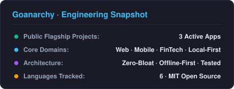
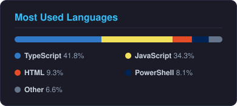

<div align="center">

# Hi, I'm Andrés (Goanarchy) 👋
### **Independent Software Developer · Building Apps, Tools & Digital Products**

<p align="center">
  <a href="https://github.com/Goanarchy"></a>
  <a href="https://x.com/goanarchy1"></a>
  
  
</p>

---

> *"I am an independent developer building end-to-end software: from mobile apps and web platforms to productivity tools, automation engines, and business systems. Fast, pragmatic, and polished."*

</div>

---

## 🚀 What I Build

As an independent software developer, I turn ideas and problems into production-ready software across multiple domains:

<table>
  <tr>
    <td width="50%" valign="top">
      <h3>🌐 Modern Web Applications</h3>
      <p>Responsive, reactive web apps, dashboards, and data-driven portals built with modern component architectures, fluid UX, and clean state management.</p>
      <p><code>React</code> · <code>Vite</code> · <code>Tailwind CSS</code> · <code>TypeScript</code> · <code>Next.js</code></p>
    </td>
    <td width="50%" valign="top">
      <h3>📱 Mobile Applications</h3>
      <p>Cross-platform mobile applications designed with a focus on intuitive interfaces, offline resilience, on-device computing, and fluid user experiences.</p>
      <p><code>React Native</code> · <code>Expo</code> · <code>Mobile Architecture</code> · <code>Zustand</code></p>
    </td>
  </tr>
  <tr>
    <td width="50%" valign="top">
      <h3>⚙️ Business Systems & Backends</h3>
      <p>Custom inventory engines, workflow managers, RESTful microservices, and internal administrative tooling that automate repetitive business operations.</p>
      <p><code>Node.js</code> · <code>Express</code> · <code>REST APIs</code> · <code>Local-First Engines</code></p>
    </td>
    <td width="50%" valign="top">
      <h3>🛠️ Developer Utilities & Automation</h3>
      <p>CLI tools, data processing pipelines, report generators, scrapers, and background daemons engineered to save time and reduce friction.</p>
      <p><code>Node.js CLI</code> · <code>Python</code> · <code>Shell / PowerShell</code> · <code>Automation</code></p>
    </td>
  </tr>
</table>

---

## 🌟 Featured Projects

<table>
  <tr>
    <td width="50%" valign="top">
      <h3><a href="https://github.com/Goanarchy/Watchdogs-NJ-Civic-Analytics">🏛️ Watchdogs Media · Civic Lab</a></h3>
      <p><strong>Bilingual New Jersey Civic Intelligence &amp; Legislative Analytics</strong></p>
      <p>EN/ES analytics platform covering all 120 NJ legislators, 11,475 bills, 100% NJ ELEC campaign finance, campaign promises, and US Census ACS 2024 5-Year district data.</p>
      <p><code>React</code> · <code>TypeScript</code> · <code>Vite</code> · <code>NJ ELEC</code> · <code>US Census ACS</code> · <code>Local-First</code></p>
    </td>
    <td width="50%" valign="top">
      <h3><a href="https://github.com/Goanarchy/HVAC-StockPro">❄️ HVAC StockPro 1.0</a></h3>
      <p><strong>Local-First Warehouse Inventory &amp; Job Costing System</strong></p>
      <p>Single-file offline HTML &amp; Node.js/Excel inventory manager for HVAC teams featuring weighted-average costing, instant PDF job receipts, and zero-loss snapshots.</p>
      <p><code>React</code> · <code>TypeScript</code> · <code>Tailwind CSS</code> · <code>Node.js</code> · <code>ExcelJS</code> · <code>jsPDF</code></p>
    </td>
  </tr>
  <tr>
    <td width="50%" valign="top">
      <h3><a href="https://github.com/Goanarchy/LingoLens">📷 LingoLens</a></h3>
      <p><strong>Offline-First Mobile Object &amp; Language Learning App</strong></p>
      <p>Cross-platform mobile application combining real-time object recognition with multi-language vocabulary flashcards and spaced repetition.</p>
      <p><code>React Native</code> · <code>Expo</code> · <code>TypeScript</code> · <code>Computer Vision</code> · <code>Spaced Repetition</code></p>
    </td>
    <td width="50%" valign="top">
      <h3><a href="https://github.com/Goanarchy/SBBT">📊 SBBT (Budget Tool)</a></h3>
      <p><strong>Small Business Financial &amp; Cash-Flow Suite</strong></p>
      <p>Bilingual (EN/ES) zero-dependency budgeting tool with cash-flow forecasting and automated Excel reporting built for small businesses.</p>
      <p><code>JavaScript</code> · <code>HTML5 / CSS3</code> · <code>Excel Automation</code> · <code>Local-First</code></p>
    </td>
  </tr>
</table>

---

## 🛠️ Technical Stack & Tooling

<div align="center">

| Area | Technologies |
|---|---|
| **Frontend & UI** | `React` · `TypeScript` · `JavaScript (ES6+)` · `Tailwind CSS` · `HTML5 / CSS3` · `State Management` |
| **Mobile Development** | `React Native` · `Expo SDK` · `Cross-Platform Mobile` · `Offline Storage` |
| **Backend & APIs** | `Node.js` · `Express.js` · `RESTful APIs` · `JSON Pipelines` · `File & Data Streaming` |
| **Data & Architecture** | `Relational & Document Data` · `Data Visualization` · `Local Storage Engines` · `Algorithm Design` |
| **Quality & Operations** | `Vitest` · `Unit & Integration Testing` · `Git & GitHub` · `Vite` · `CI / Automation Scripts` |

</div>

---

## 💡 How I Work as an Independent Developer

```
  ┌───────────────────────┐     ┌───────────────────────┐     ┌───────────────────────┐
  │  End-to-End Ownership │     │ Pragmatic Engineering │     │  User-Centered Craft  │
  │ From initial concept  │ ──► │ Pick the right stack  │ ──► │ Polished details,     │
  │ to architecture, code │     │ without bloat. Build  │     │ fast load times, and  │
  │ and deployment.       │     │ things that work.     │     │ zero unnecessary drag.│
  └───────────────────────┘     └───────────────────────┘     └───────────────────────┘
```

1. **Full-Cycle Execution:** I don't just write code; I design solutions, architect data flows, build intuitive user experiences, and ensure the entire app functions reliably.
2. **Speed & Pragmatism:** I choose clean, maintainable tech stacks that allow for fast iteration without carrying technical debt or fragile dependencies.
3. **Versatility:** Whether it is a quick desktop utility, a mobile tool, a business administrative system, or a full-scale web application, I adapt to the right tool for the job.

---

## 📊 Live GitHub Activity

<div align="center">




</div>

---

<div align="center">

### 🤝 Available for Independent Projects & Collaborations
Have an app, tool, or product you need built from scratch or taken to the next level?  
**Let's build something great together.** Connect with me on [GitHub](https://github.com/Goanarchy) or reach out on [X (@goanarchy1)](https://x.com/goanarchy1).

</div>
